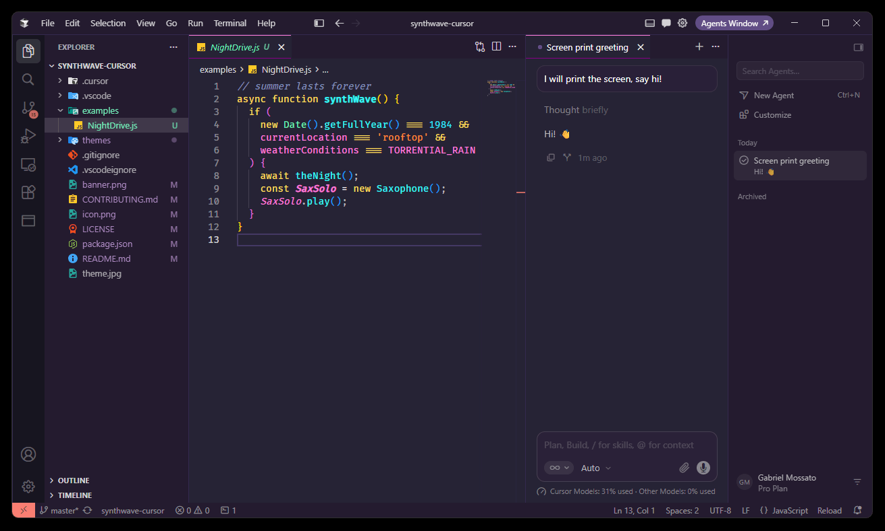

# SynthWave '84 Cursor




SynthWave '84 Cursor is a full fork of [Robb Owen's SynthWave '84](https://github.com/robb0wen/synthwave-vscode), maintained by [gvmossato](https://github.com/gvmossato) for Cursor.

The neon palette is the original one: purple backgrounds, pink, coral, cyan, yellow, and green. This fork adapts that theme to current Cursor chrome. Home-screen tiles, tabs, panels, inputs, and semantic highlighting use those colours instead of falling back to VS Code's default dark gray.

## No Neon Dreams

This theme does not include Neon Dreams. That was the upstream glow effect, and it worked by rewriting the editor's own install files. This fork does not ship that command, those styles, or any patch to Cursor. Colours come only from the theme file.

Open [examples/NightDrive.js](examples/NightDrive.js) with **SynthWave '84 Cursor** active if you want a fresh screenshot of the palette. That file is the sample from the old glow image, without the glow.

## Agents window

The separate Cursor Agents window does not use custom themes. It only offers Cursor Dark, Cursor Light, and Cursor Dark High Contrast. This theme colours the editor window, including chat inside the editor. It cannot colour the Agents window.

## Install

You need Node.js 22 or newer. This repo is developed on Node.js 24.21.0, recorded in `.nvmrc`. Packaging uses the pinned `@vscode/vsce` in this repo.

1. From this folder, install the packaging tool and build the extension:

```bash
npm ci
npm run package
```

`npm run check` lists the files that will go into the VSIX.

2. In Cursor, open the Command Palette and run **Extensions: Install from VSIX…**. Pick the generated `synthwave-cursor-0.2.0.vsix`.
3. Open the Command Palette and run **Preferences: Color Theme**, then choose **SynthWave '84 Cursor**. Reload the window if the home screen does not refresh.

After you change the theme, package and install the VSIX again the same way. The original Marketplace extension can stay installed. Its theme name is **SynthWave '84**, and this one is **SynthWave '84 Cursor**.

## Develop

Open this folder in Cursor and use **Run Extension** (`.vscode/launch.json`). That starts an Extension Development Host with this folder loaded as the theme.

## License

MIT. The original theme is copyright Robb Owen (2019). Changes in this fork are copyright Gabriel Mossato (2026). See [LICENSE](LICENSE).
